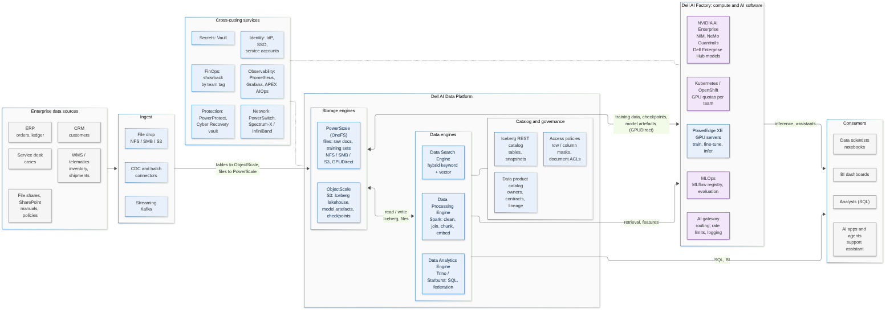
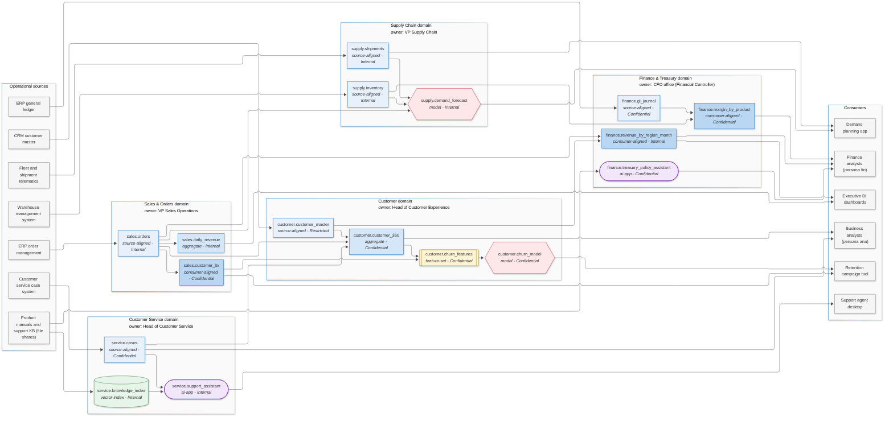
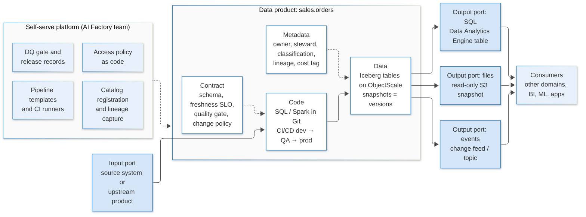
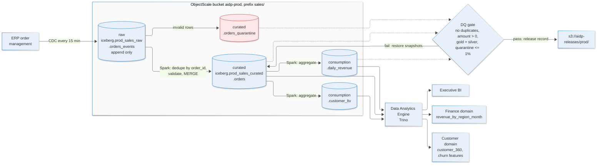
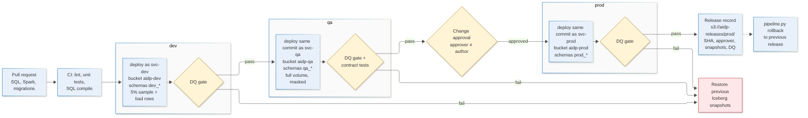
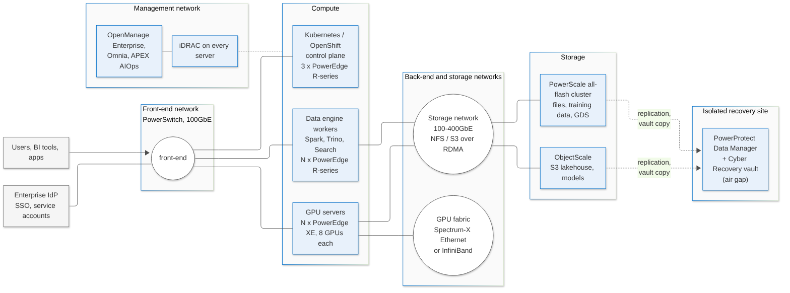
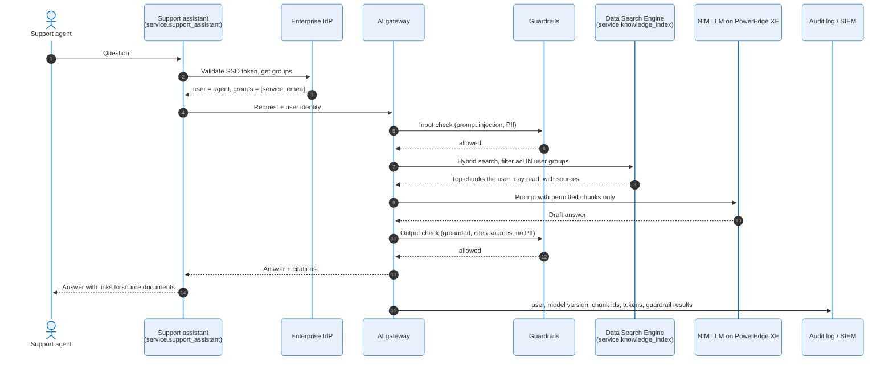

# Sample architecture: data domains and data products on Dell AI Data Platform

A worked example of how an enterprise could organise its data on the Dell AI Data Platform (AIDP) and Dell AI Factory. It covers business **domains** that own **data products**, the platform those products run on, and the diagrams to show it.

Everything here is a **sample** ("Acme"). Use it as a starting draft in the questionnaire workshops and replace it with your own domains, owners and products. The answers it helps you decide include `DAT-02` owners and stewards, `DAT-11` data contracts, `LAK-05` the layer model, `PLT-09` environments and `ARC-01` reference architecture.

> **Not checked against Dell documentation.** dell.com blocks the build VM, so component names (Data Processing / Analytics / Search Engine, PowerScale, ObjectScale, PowerEdge XE, PowerSwitch, PowerProtect Cyber Recovery, APEX AIOps) come from general knowledge. Node counts and network speeds are placeholders. Confirm both with your Dell account team, and size from the `CMP`, `STO` and `NET` answers.

## Files

| Path | What it is |
|---|---|
| [`data-products.yaml`](data-products.yaml) | Source of truth: naming conventions, sources, domains, data products, consumers |
| [`data-product-catalog.md`](data-product-catalog.md) | Generated catalog: one contract table per data product |
| [`diagrams/*.mmd`](diagrams/) | Mermaid sources (plain text, editable, displayed by GitHub) |
| `diagrams/*.svg`, `diagrams/*.png` | Rendered diagrams for documents and slides; `diagrams/rendered.json` records which source each was rendered from, so `--check` catches stale images |
| [`../tools/build_architecture.py`](../tools/build_architecture.py) | Validates the YAML, regenerates the catalog and diagram 02, renders all diagrams |

## Diagrams

| # | Diagram | Shows | Source |
|---|---|---|---|
| 1 | [Logical architecture](#1-logical-architecture) | Sources → ingest → AIDP storage and engines → AI Factory → consumers, plus cross-cutting services | [01](diagrams/01-logical-architecture.mmd) |
| 2 | [Domain and data product map](#2-domain-and-data-product-map) | 5 domains, 17 products, and which product feeds which | [02](diagrams/02-domain-product-map.mmd) (generated) |
| 3 | [Data product anatomy](#3-data-product-anatomy) | What every product contains: code, data, contract, metadata, output ports | [03](diagrams/03-data-product-anatomy.mmd) |
| 4 | [Sales orders data flow](#4-sales-orders-data-flow) | Raw → curated → consumption with the DQ gate, mapped to buckets, schemas and engines | [04](diagrams/04-sales-orders-data-flow.mmd) |
| 5 | [Environment promotion](#5-environment-promotion) | Same commit dev → QA → prod with gates, approval, release record and rollback | [05](diagrams/05-environment-promotion.mmd) |
| 6 | [Physical deployment](#6-physical-deployment) | Server roles, networks, storage, management and the isolated recovery site | [06](diagrams/06-physical-deployment.mmd) |
| 7 | [RAG request with access control](#7-rag-request-with-access-control) | One assistant request: SSO, guardrails, document ACLs, citations, audit | [07](diagrams/07-rag-request-access-control.mmd) |

### 1. Logical architecture


AIDP is the data half: storage engines (PowerScale for files, ObjectScale for S3 and the Iceberg lakehouse), data engines, and catalog and governance. The AI Factory is the compute and AI-software half that reads from it. Identity, secrets, observability, protection, FinOps and the network apply to both.

### 2. Domain and data product map


Each box is a data product owned by one domain. Shapes show the product type (see below). Arrows go from input to product. A domain uses another domain's product through its output port and never copies the source tables.

### 3. Data product anatomy


### 4. Sales orders data flow


Lab [B08](../labs/guides/B-data-engines/B08-dev-qa-prod-pipeline.md) runs this flow. The lab keeps one domain, so its schemas are `<env>_curated` instead of `<env>_sales_curated`, and the curated table is `orders_clean`.

### 5. Environment promotion


### 6. Physical deployment


### 7. RAG request with access control


## Domains

| Domain | Owner | Products | Example product |
|---|---|---|---|
| Sales & Orders (`sales`) | VP Sales Operations | 3 | `sales.orders` is the system of record for order facts |
| Customer (`customer`) | Head of Customer Experience | 4 | `customer.customer_master` holds all customer PII, masked for everyone else |
| Finance & Treasury (`finance`) | CFO office | 4 | `finance.treasury_policy_assistant` is the [X01](../labs/guides/X-capstone/X01-capstone-tenant.md) tenant |
| Supply Chain (`supply`) | VP Supply Chain | 3 | `supply.demand_forecast` is a model published as a table |
| Customer Service (`service`) | Head of Customer Service | 3 | `service.knowledge_index` powers the support assistant |

Contracts for all 17 products are in the [catalog](data-product-catalog.md).

## Data product types

| Type | Shape in diagram 2 | Meaning | Example |
|---|---|---|---|
| source-aligned | rectangle, light | Cleaned copy of one operational source, owned by the domain that runs that source | `sales.orders` |
| aggregate | rectangle, mid | Joins or summarises products, usually inside one domain | `customer.customer_360` |
| consumer-aligned | rectangle, dark | Shaped for a specific use: report, dashboard, app | `finance.revenue_by_region_month` |
| feature-set | double-edged rectangle | Point-in-time features for ML training and scoring | `customer.churn_features` |
| vector-index | cylinder | Chunked, embedded documents with per-document ACLs | `service.knowledge_index` |
| model | hexagon | Registered model with champion / challenger; output is a table or endpoint | `customer.churn_model` |
| ai-app | stadium | Assistant or agent served through the AI gateway | `service.support_assistant` |

## Naming conventions

A starting answer for `ARC-03`.

| Object | Pattern | Example (prod) |
|---|---|---|
| Product ID | `<domain>.<product>` | `sales.orders` |
| Iceberg table | `iceberg.<env>_<domain>_<layer>.<product>` | `iceberg.prod_sales_curated.orders` |
| Object storage | `s3://aidp-<env>/<domain>/<layer>/<product>/` | `s3://aidp-prod/sales/curated/orders/` |
| File storage | `/ifs/aidp/<env>/<domain>/<product>/` | `/ifs/aidp/prod/service/knowledge_index/` |
| Search index | `<env>-<domain>-<product>` | `prod-service-knowledge-index` |
| Model | `<domain>.<product>@<alias>` | `customer.churn_model@champion` |
| Service account | `svc-<env>-<domain>` | `svc-prod-sales` (B08 uses `svc-<env>` for its single domain) |
| Layers | `raw` → `curated` → `consumption` | bronze → silver → gold (`LAK-05`) |
| Classification | Public, Internal, Confidential, Restricted | `customer.customer_master` is Restricted (`DAT-01`) |

## Who does what

| Activity | Domain team | AI Factory platform team |
|---|---|---|
| Define products, contracts, quality rules | Owns | Provides templates |
| Pipeline code, tests, migrations | Owns | Provides CI runners and the dev → QA → prod workflow |
| Approve prod release | Product owner approves; approver is not the author | Enforces the approval in CI |
| Access requests to a product | Data owner approves | Applies policy as code (Trino rules, document ACLs, S3 policies) |
| Storage, engines, GPUs, catalog | Consumes | Owns and operates |
| Incidents in a product (bad data, SLO miss) | On call for the product | On call for the platform |
| Cost | Pays by showback tag | Meters and reports (`FIN-03`) |

## Build the sample in the lab

| Sample product | Lab that builds it on the SIM environment |
|---|---|
| `sales.orders`, `sales.daily_revenue`, `sales.customer_ltv` | [B08](../labs/guides/B-data-engines/B08-dev-qa-prod-pipeline.md) (dev → QA → prod), [B04](../labs/guides/B-data-engines/B04-data-processing-spark.md) |
| `customer.customer_master` with masks | [B01](../labs/guides/B-data-engines/B01-federated-sql.md), [B03](../labs/guides/B-data-engines/B03-lakehouse-governance.md) |
| `service.knowledge_index`, `service.support_assistant` | [B06](../labs/guides/B-data-engines/B06-unstructured-search.md), [D03](../labs/guides/D-ai-software/D03-rag-end-to-end.md), [D05](../labs/guides/D-ai-software/D05-guardrails-evaluation.md) |
| `customer.churn_model`, `supply.demand_forecast` | [D07](../labs/guides/D-ai-software/D07-mlops-pipeline.md) |
| `finance.treasury_policy_assistant` | [X01](../labs/guides/X-capstone/X01-capstone-tenant.md) |

## Edit and regenerate

```bash
pip install -r requirements.txt                 # PyYAML
npm install -g @mermaid-js/mermaid-cli          # only needed for --render (or set MMDC=/path/to/mmdc)
python3 tools/build_architecture.py --render    # validate, regenerate catalog + diagram 02, render SVG/PNG
python3 tools/build_architecture.py --check     # CI: fails if the catalog or diagrams are stale
python3 tools/check_lab_guides.py               # question IDs and relative links
```

The script rejects unknown domains, inputs, consumers, questionnaire IDs and lab IDs, as well as sources or consumers that nothing uses. To change a diagram other than 02, edit its `.mmd` file and run `--render`. To edit visually, paste the `.mmd` into [mermaid.live](https://mermaid.live), or import it into draw.io (Arrange → Insert → Advanced → Mermaid).
