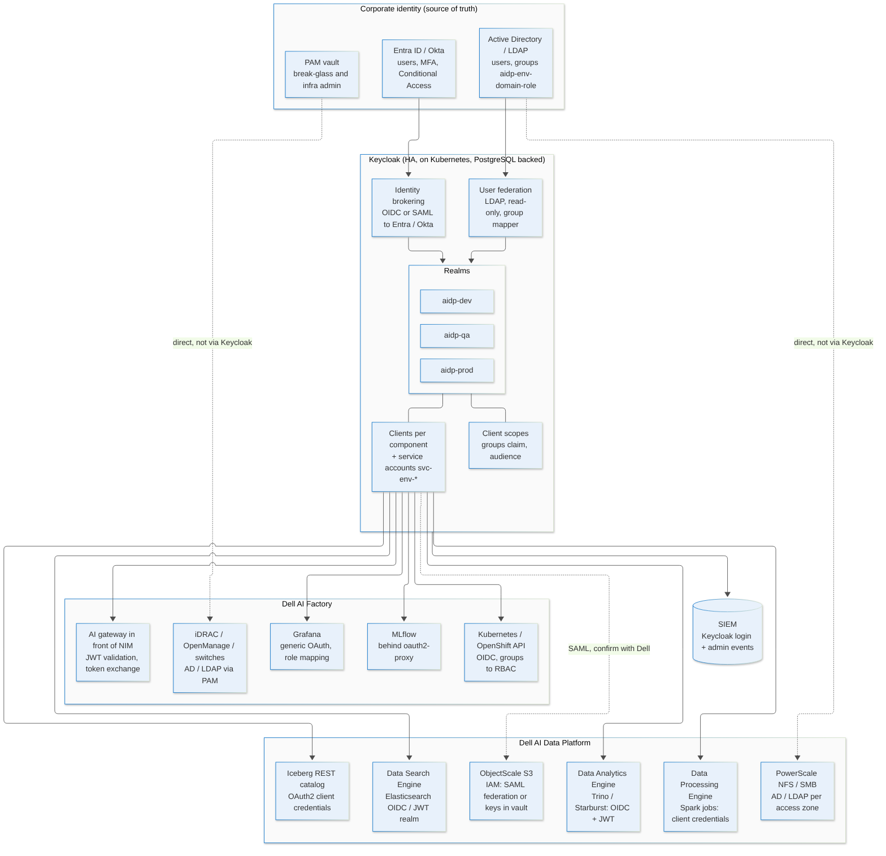
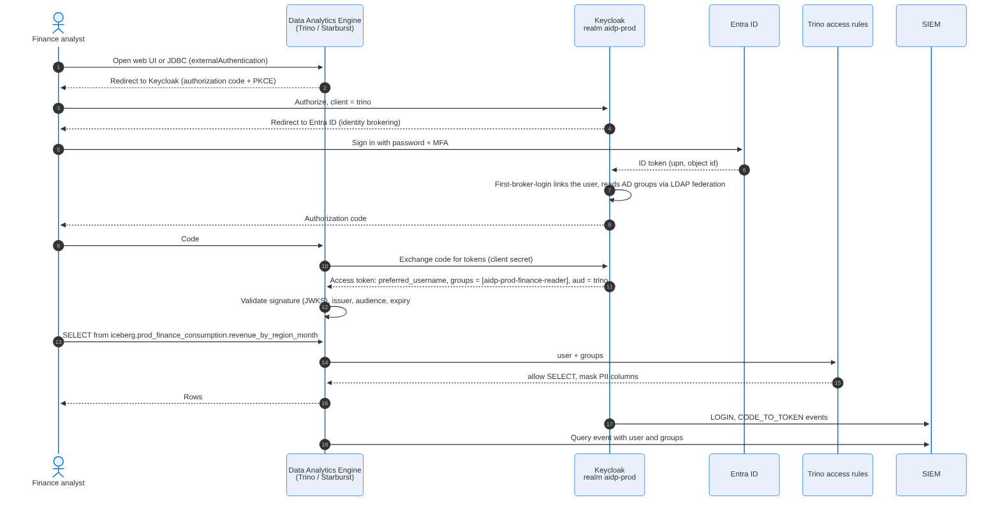
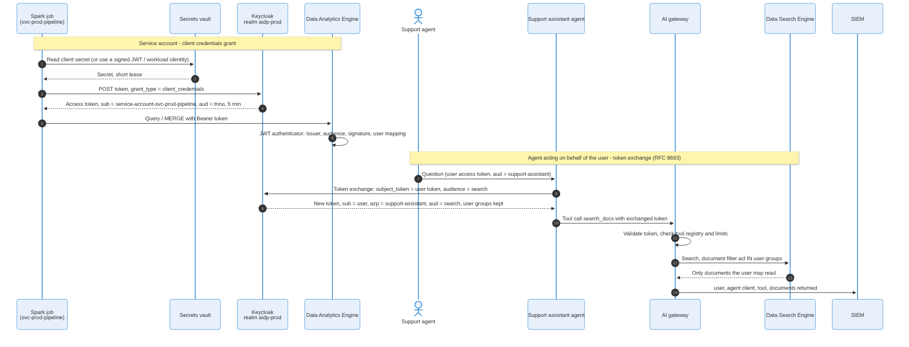

# Identity design: Keycloak as the identity broker for Dell AIDP and AI Factory

How users, pipelines and AI agents get one identity across the Dell AI Data Platform (AIDP) and the Dell AI Factory, with Keycloak between the corporate identity provider (IdP) and every platform component. It follows the sample domains, environments and naming in this folder ([README](README.md), [catalog](data-product-catalog.md)) and the dev → QA → prod separation of lab [B08](../labs/guides/B-data-engines/B08-dev-qa-prod-pipeline.md).

> **Status: design draft, not validated.** dell.com blocks the build VM, so nothing here was checked against Dell documentation or run on Dell products. In particular, confirm with Dell: whether your AIDP release ships its own identity service or Keycloak, the authentication settings of the Data Analytics Engine (Starburst) and Data Search Engine, ObjectScale identity federation, and OneFS web UI SSO. The open-source settings (Keycloak 26, Trino, Elasticsearch 8, Kubernetes, Grafana, oauth2-proxy) are from their public documentation and are **illustrative and untested** in this repo. Lab environment support for Keycloak is not built yet.

Questionnaire answers this document proposes: `SEC-01` identity source and SSO, `SEC-02` authorisation model, `SEC-04` TLS, `SEC-05` secrets, `SEC-09` privileged access, `SEC-10` SIEM logging, `LAK-09` query-layer access control, `RAG-03` document-level permissions, `AGT-04` agent identity, `AGT-06` agent audit trail, `ARC-03` naming.

## 1. Decisions in one page

| # | Decision | Proposed standard | Why |
|---|---|---|---|
| D1 | Source of truth for people | Corporate IdP (Entra ID in this sample; Okta or AD work the same way) | One joiner/mover/leaver process, MFA and Conditional Access stay where they already are |
| D2 | Role of Keycloak | Identity broker and token issuer for the platform. Holds no passwords | Every component trusts one OIDC issuer per environment; the corporate IdP is not reconfigured for each new tool |
| D3 | Realms | One realm per environment: `aidp-dev`, `aidp-qa`, `aidp-prod` | A dev token is signed by a different key and issuer, so prod rejects it. Matches B08's per-environment buckets, schemas and service accounts |
| D4 | Groups | Managed in AD/Entra, named `aidp-<env>-<domain>-<role>`, read into the matching realm | Access reviews happen in one place; rules reference groups, never users |
| D5 | Authorisation | RBAC from groups at every component; ABAC (tags, row filters, column masks) at the query layer and search | `SEC-02`, `LAK-09`, `RAG-03` |
| D6 | Service identities | One Keycloak client with a service account per pipeline per environment (`svc-<env>-<pipeline>`), client-credentials grant, secret in the vault | No shared or personal credentials in jobs; tokens expire in minutes |
| D7 | Agents | Token exchange: the agent swaps the user's token for one scoped to the tool, keeping the user as subject | `AGT-04` on-behalf-of: an agent can never see more than the user it serves |
| D8 | What stays out of Keycloak | PowerScale NFS/SMB (AD/Kerberos per access zone), iDRAC/OpenManage/switch admin (AD/LDAP through PAM) | These protocols do not use OIDC; infrastructure admin is brokered by PAM (`SEC-09`) |
| D9 | Tokens | Access token 5 min, SSO idle 30 min, SSO max 10 h; MFA enforced by the corporate IdP, plus step-up for prod admin roles | Short-lived bearer tokens limit replay; refresh does not bypass leaver removal for long |
| D10 | Audit | Keycloak login and admin events, and each component's access log with user and groups, go to the SIEM | `SEC-10`, `AGT-06` |

## 2. Federation architecture



Source: [08](diagrams/08-identity-federation.mmd)

- **Brokering.** Each realm has an identity provider entry for Entra ID (OpenID Connect v1.0, or SAML 2.0). Users click "Sign in with corporate account"; Keycloak redirects, Entra applies MFA and Conditional Access, and Keycloak issues its own tokens. Set the realm to redirect straight to Entra (default identity provider) so users never see a Keycloak login form. With Okta it is the same OIDC entry; with AD only, skip brokering and use LDAP federation with Kerberos/SPNEGO or the Keycloak form.
- **Groups.** Brokered Entra tokens can carry group IDs, but large tenants hit the groups-claim limit. The more robust pattern is LDAP **user federation** in read-only mode, with a group mapper filtered to `(cn=aidp-<env>-*)`, so the `aidp-prod` realm only ever sees prod groups. Alternative: Entra app roles mapped to Keycloak groups.
- **Realm per environment.** Each realm has its own signing keys and issuer URL (`https://sso.example.com/realms/aidp-prod`). Components in prod trust only the prod issuer. The `master` realm is used only for Keycloak administration, by break-glass accounts held in PAM.

## 3. Realm, client and group design

### Groups and roles (naming follows `ARC-03`)

| Group (in AD / Entra) | Realm | Grants |
|---|---|---|
| `aidp-prod-<domain>-reader` | aidp-prod | `SELECT` on `iceberg.prod_<domain>_consumption.*`; search on the domain's indexes; dashboards Viewer |
| `aidp-prod-<domain>-engineer` | aidp-prod | read curated; no direct writes in prod (writes come only from `svc-prod-*`) |
| `aidp-dev-<domain>-engineer` | aidp-dev | read/write `iceberg.dev_<domain>_*`; deploy to dev |
| `aidp-prod-<domain>-steward` | aidp-prod | manage tags, masks and row filters for the domain; approve access requests |
| `aidp-prod-pii-reader` | aidp-prod | unmasked PII columns (time-bound, approved) |
| `aidp-<env>-platform-admin` | each | Kubernetes cluster-admin, Grafana Admin, Keycloak realm-admin (step-up MFA) |
| `aidp-<env>-ml-engineer` | each | MLflow write, model registry aliases in dev/qa; prod aliases only through the release pipeline |
| `aidp-prod-security-auditor` | aidp-prod | read-only on audit logs, access rules and Keycloak events |

Example: a finance analyst is in `aidp-prod-finance-reader`; she can query `finance.revenue_by_region_month`, cannot read `sales.orders` curated data, and sees `customer_master` columns masked.

### Clients (one set per realm)

| Client ID | Type | Flow | Used by |
|---|---|---|---|
| `trino` | confidential | authorization code + PKCE; also the audience for bearer tokens | Data Analytics Engine web UI, CLI and JDBC (`externalAuthentication=true`) |
| `search` | confidential | authorization code (Kibana), bearer (API) | Data Search Engine |
| `grafana` | confidential | authorization code | Grafana |
| `mlflow-proxy` | confidential | authorization code | oauth2-proxy in front of MLflow |
| `kubernetes` | public | authorization code + PKCE (kubelogin) | `kubectl`, OpenShift console |
| `ai-gateway` | bearer only (no login) | validates tokens | AI gateway in front of NIM |
| `support-assistant` | confidential | authorization code; token exchange enabled | `service.support_assistant` |
| `svc-<env>-<pipeline>` | confidential, service account on, standard flow off | client credentials | Spark jobs, B08 pipeline, CI |

### Client scopes

- `groups`: Group Membership mapper, claim `groups`, full path off, added to ID and access tokens.
- `aud-trino`, `aud-search`, ...: Audience mappers so a token is valid only for the component it was issued for. Components must check `aud`.
- No `offline_access` for people; service accounts do not get refresh tokens.

## 4. Component integration

| Component | Integration | Identity in the token | Authorisation | Confirm with Dell |
|---|---|---|---|---|
| Data Analytics Engine (Trino / Starburst) | OIDC for browser, CLI and JDBC; JWT bearer for services | `preferred_username`, `groups` | Access-control rules per catalog/schema/table, row filters and column masks by group (lab [B03](../labs/guides/B-data-engines/B03-lakehouse-governance.md)) | Starburst-specific settings and built-in access control |
| Data Processing Engine (Spark) | Jobs run as a Kubernetes service account and get a Keycloak token with client credentials for Trino and the catalog | `service-account-svc-<env>-<pipeline>` | Writes only to its environment's schemas and bucket | How the engine injects job identity |
| Iceberg REST catalog | OAuth2 client credentials (`credential=client_id:secret`) | service client | Catalog permissions per namespace | Catalog product in your AIDP release |
| ObjectScale (S3) | Preferred: IAM identity federation (SAML from Keycloak, assume role). Fallback: one access key per service, stored in the vault and rotated | role / IAM user | Bucket policy per environment `aidp-<env>` (lab [A09](../labs/guides/A-storage/A09-objectscale-s3.md)) | **Whether ObjectScale federation works with Keycloak in your version** |
| PowerScale (NFS / SMB / S3) | Not Keycloak. AD (Kerberos) or LDAP auth provider per access zone (lab [A02](../labs/guides/A-storage/A02-access-zones-quotas.md)), the same directory Keycloak reads | AD user / group SID | File ACLs, zone RBAC | Web UI SAML SSO support in your OneFS version |
| Data Search Engine (Elasticsearch) | OIDC realm for Kibana; JWT realm for API calls from the gateway | `preferred_username`, `groups` | Role mapping on groups; document-level security on an `acl` field (`RAG-03`, diagram 07) | Licence tier that includes OIDC/JWT realms |
| Kubernetes / OpenShift | API server OIDC (`--oidc-issuer-url`, `--oidc-groups-claim=groups`, prefix `oidc:`); OpenShift OAuth with an OpenID identity provider | user, groups | RoleBindings to `oidc:aidp-<env>-*` groups | - |
| AI gateway → NIM | Gateway validates the JWT (issuer, audience, expiry, JWKS) before routing to NIM; NIM endpoints are not exposed directly | user or agent | Model allow-list per group, rate and cost limits (`AGT-07`) | - |
| MLflow | oauth2-proxy (`--provider=keycloak-oidc`, `--allowed-group`) in front of the tracking server | `X-Forwarded-User` | Write to registry aliases only via CI in prod | - |
| Grafana | `[auth.generic_oauth]` with `role_attribute_path` on `groups` | user, groups | Viewer / Editor / Admin by group | - |
| iDRAC, OpenManage, switches | AD / LDAP through the PAM vault (`SEC-09`), not Keycloak | admin account | Least privilege per device role | - |

### Trino / Data Analytics Engine example (illustrative, untested)

```properties
# config.properties - OIDC for people, JWT for services. Requires HTTPS.
http-server.https.enabled=true
http-server.https.port=8443
http-server.https.keystore.path=/etc/trino/tls/trino.pem
internal-communication.shared-secret=${ENV:TRINO_SHARED_SECRET}
http-server.authentication.type=OAUTH2,JWT
web-ui.authentication.type=oauth2
http-server.authentication.oauth2.issuer=https://sso.example.com/realms/aidp-prod
http-server.authentication.oauth2.client-id=trino
http-server.authentication.oauth2.client-secret=${ENV:TRINO_OIDC_SECRET}
http-server.authentication.oauth2.scopes=openid,groups
http-server.authentication.oauth2.principal-field=preferred_username
http-server.authentication.oauth2.groups-field=groups
http-server.authentication.jwt.key-file=https://sso.example.com/realms/aidp-prod/protocol/openid-connect/certs
http-server.authentication.jwt.required-issuer=https://sso.example.com/realms/aidp-prod
http-server.authentication.jwt.required-audience=trino
http-server.authentication.jwt.principal-field=preferred_username
http-server.authentication.jwt.user-mapping.pattern=(?:service-account-)?(.*)
```

```json
{ "tables": [
  { "group": "aidp-prod-finance-reader", "catalog": "iceberg", "schema": "prod_finance_consumption", "privileges": ["SELECT"] },
  { "user": "svc-prod-finance-pipeline", "catalog": "iceberg", "schema": "prod_finance_.*", "privileges": ["SELECT", "INSERT", "DELETE", "UPDATE", "OWNERSHIP"] },
  { "catalog": "iceberg", "schema": "prod_.*", "privileges": [] }
] }
```

Service accounts do not get a `groups` claim from the JWT authenticator, so rules name them by user; people are matched by group.

### Keycloak realm as code (sketch)

Manage realms with the Keycloak Terraform provider or `keycloak-config-cli` from Git, reviewed like B08 code, so dev, QA and prod realms differ only in variables:

```hcl
resource "keycloak_realm" "aidp" {
  realm                    = "aidp-${var.env}"
  access_token_lifespan    = "5m"
  sso_session_idle_timeout = "30m"
  sso_session_max_lifespan = "10h"
}

resource "keycloak_openid_client" "svc_pipeline" {
  realm_id                 = keycloak_realm.aidp.id
  client_id                = "svc-${var.env}-finance-pipeline"
  access_type              = "CONFIDENTIAL"
  service_accounts_enabled = true
  standard_flow_enabled    = false
}
```

## 5. Sign-in and token flows

### 5.1 A person signs in and queries data



Source: [09](diagrams/09-user-sso-flow.mmd)

### 5.2 Pipelines and agents



Source: [10](diagrams/10-service-and-agent-tokens.mmd)

- **Pipelines** use the client-credentials grant. The secret lives in the vault (`SEC-05`) with a short lease; a stronger option is a signed-JWT client assertion or Kubernetes workload identity so no shared secret exists. Each environment's pipeline has its own client in its own realm (B08's `svc-dev`, `svc-qa`, `svc-prod`).
- **Agents** use standard token exchange (RFC 8693, enabled per client in Keycloak 26.2+). The exchanged token keeps the user as subject, records the agent in `azp`, and is limited to the tool's audience. Tools and the gateway authorise on the user's groups and log both identities (`AGT-04`, `AGT-06`, lab [D06](../labs/guides/D-ai-software/D06-agentic-ai.md)).
- **The RAG assistant** in diagram [07](diagrams/07-rag-request-access-control.mmd) gets the user's groups from this token instead of asking the IdP directly.

## 6. Operating Keycloak

| Area | Standard |
|---|---|
| Deployment | Keycloak Operator on the platform Kubernetes cluster, at least 2 replicas per site, external PostgreSQL with backups, TLS from the enterprise CA (`SEC-04`), admin console reachable only from the management network |
| Availability | If Keycloak is down, nobody can sign in, but tokens already issued stay valid until expiry and components keep validating with cached signing keys. Size the DR plan accordingly (lab [E04](../labs/guides/E-operations/E04-dr-drill.md)) |
| Configuration | Realms, clients, scopes and mappers in Git (Terraform / keycloak-config-cli); manual console changes in prod are drift and are reverted |
| Keys | Rotate realm signing keys at least yearly: add a new key with higher priority, keep the old one passive until all tokens it signed have expired, then remove it |
| Secrets | Client secrets generated by Keycloak, copied only into the vault, rotated on a schedule and on staff change |
| Privileged access | `master` realm and realm-admin roles only through PAM with step-up MFA; no personal admin accounts (`SEC-09`) |
| Audit | Enable login events and admin events (with representation) in every realm; ship them to the SIEM with each component's access log (`SEC-10`); alert on admin changes in `aidp-prod`, failed-login spikes and new service-account clients |
| Leavers | Disabling the user in Entra/AD blocks new sign-ins at once; existing access tokens die within 5 minutes; LDAP sync or brokered login refreshes groups on next sign-in |
| Access reviews | Quarterly per domain on the `aidp-prod-<domain>-*` groups, run by the domain owner and steward (`DAT-02`) |

## 7. Acceptance tests

Run these in each environment before go-live (they become the Keycloak lab):

- [ ] Signing in to the Data Analytics Engine, Search, Grafana and MLflow redirects to Entra, applies MFA, and lands with the right groups in the token.
- [ ] A `aidp-prod-finance-reader` user can query `prod_finance_consumption` and is denied `prod_sales_curated`; PII columns are masked.
- [ ] A token from realm `aidp-dev` is rejected by every prod component (wrong issuer and key).
- [ ] A token issued for `aud = search` is rejected by Trino.
- [ ] `svc-prod-finance-pipeline` can write only to `prod_finance_*` and `s3://aidp-prod/finance/`.
- [ ] An agent's exchanged token returns only documents the user can read; the trace has user, agent and tool.
- [ ] Disabling the user in AD blocks a new sign-in immediately and existing sessions within the token lifetime.
- [ ] Keycloak login and admin events and the component query logs are visible in the SIEM.
- [ ] Stopping one Keycloak replica causes no sign-in failures.

## 8. Open questions for the workshop

| Question | Questionnaire |
|---|---|
| Which corporate IdP is authoritative for people, and for service accounts? Is Keycloak approved as the platform broker, or must components trust Entra/Okta directly? | `SEC-01` |
| RBAC only, or RBAC plus tag-based ABAC at the query and search layers? | `SEC-02`, `LAK-09` |
| Must every RAG query enforce source-document permissions? | `RAG-03` |
| Do agents act on behalf of users, under their own service identity, or both by risk tier? | `AGT-04` |
| Which PAM tool brokers infrastructure and Keycloak admin access? | `SEC-09` |
| Which identity events go to the SIEM, and for how long? | `SEC-10` |
| Does your AIDP release include an identity service, and which of the "Confirm with Dell" items above apply? | `ARC-01` |
