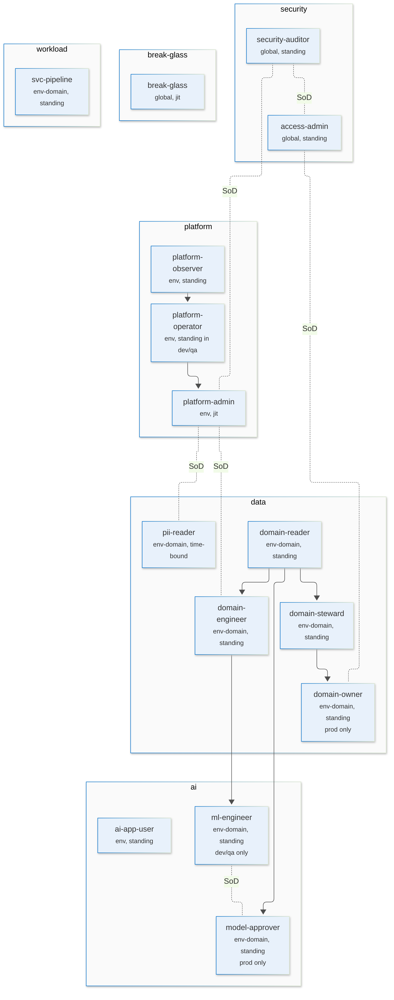

# Roles and privileges standard for Dell AIDP and AI Factory

How the SRE team defines who can do what on the Dell AI Data Platform (AIDP) and AI Factory: the principles, the role hierarchy, the privileges each role has in each component, separation of duties, and how roles are granted, reviewed and tested. It builds on the identity design in [identity-keycloak.md](identity-keycloak.md) (groups come from AD / Entra through Keycloak) and the sample domains in [data-products.yaml](data-products.yaml).

> **Status: design draft.** The role model is a sample to adapt in the questionnaire workshops. The query-layer part is generated as a Trino policy and tested on the lab environment (lab [E07](../labs/guides/E-operations/E07-roles-and-privileges.md)). Privileges for Dell components (ObjectScale, PowerScale / OneFS, Data Analytics / Search Engine, iDRAC / OpenManage) are written from general knowledge, are **not checked against Dell documentation** (dell.com blocks the build VM) and are **untested**. Map them to the built-in roles of your Dell releases with your Dell team.

Questionnaire answers this document proposes: `SEC-02` access model, `SEC-09` privileged access, `SEC-10` audit logging, `LAK-09` query-layer access control, `RAG-03` document permissions, `AGT-04` agent identity, `DAT-02` owners and stewards, `ARC-03` naming.

## Files

| Path | What it is |
|---|---|
| [`roles.yaml`](roles.yaml) | Source of truth: roles, inheritance, privileges per component, separation of duties, masks, test personas |
| [`roles-matrix.md`](roles-matrix.md) | Generated: role list, effective query-layer grants, privileges per component, SoD pairs |
| [`diagrams/11-role-hierarchy.mmd`](diagrams/11-role-hierarchy.mmd) | Generated hierarchy diagram |
| [`../labs/env/trino/roles/`](../labs/env/trino/roles/) | Generated Trino policy (`rules.json`) and lab group file (`group.txt`) |
| [`../tools/build_roles.py`](../tools/build_roles.py) | Validates `roles.yaml` and writes the generated files; `--check` fails if they are stale |

Change a role by editing `roles.yaml`, running `python3 tools/build_roles.py`, then `python3 tools/build_architecture.py --render` for the diagram. Review the diff of `rules.json` like any code change.

## 1. Who owns what

| Responsibility | Owner | Why |
|---|---|---|
| Role framework: naming, tiers, this standard, `roles.yaml` | **SRE** | One consistent model across every component |
| Platform roles (`platform-*`) and break-glass procedure | **SRE** (break-glass co-owned with the CISO) | SRE runs the platform |
| Enforcement: Keycloak realms, Trino / Search / Kubernetes / storage policies generated from `roles.yaml` | **SRE** | Policy as code, deployed through the same pipeline in every environment |
| Who may see a domain's data (membership of `domain-*`, `pii-reader`) | **Domain owner** (privacy officer as well for PII) | The owner is accountable for the data; SRE granting business-data access to itself would break separation of duties |
| Applying approved membership changes in AD / Entra | **IAM (`access-admin`)** | The approver and the person who applies the change differ |
| Independent review of grants and logs | **Security (`security-auditor`)** | Auditors do not grant or administer |

This split is the default. If your SRE team must also approve data access, record it as an exception in `SEC-02` and add a compensating control, such as a monthly review by the domain owners.

## 2. Principles

1. **Bottom-up: privilege → role → group → person.** A privilege is one action on one resource (`SELECT` on `iceberg.prod_finance_consumption`). A role bundles privileges for a job. A group (`aidp-<env>-<domain>-<role>`) assigns a role in one scope. People join groups; nobody is granted a privilege directly.
2. **Deny by default, least privilege.** Every generated policy ends with a deny-all rule. No wildcard admin outside break-glass.
3. **Few, composable roles.** 15 role definitions cover every domain and environment through scoping (110 groups in the sample). Masks and row filters come from data classification tags, not from more roles.
4. **Shallow hierarchy, at most 3 levels.** Each higher role adds a few clear rights. The validator rejects deeper chains and cycles.
5. **Separation of duties** is a list of role pairs no person may hold, in any combination of environments (building in dev and approving in prod is still a conflict). The validator checks it for roles (through inheritance) and for people (the persona list; in production, the group export from AD).
6. **No standing admin in prod.** `platform-admin` and `break-glass` are elevated just-in-time through PAM with a ticket and an expiry.
7. **Only service accounts write to prod.** The validator rejects any human role with write access in prod. People change prod through the release pipeline ([B08](../labs/guides/B-data-engines/B08-dev-qa-prod-pipeline.md)).
8. **Platform roles do not see business data.** `platform-*` can operate the engines (see and kill queries, quotas, restarts) but have no `SELECT` on domain schemas.
9. **Every role has an owner, an approver and a maximum duration** (in `roles.yaml`). Membership is reviewed quarterly; time-bound roles expire automatically.
10. **Roles as code, audited.** `roles.yaml` and the generated policies live in Git and go through review. Grants, elevations, denied requests and policy changes go to the SIEM.

## 3. Role hierarchy

Source: [11](diagrams/11-role-hierarchy.mmd) (generated). A solid arrow A → B means B has all of A's privileges plus its own. A dotted line is a separation-of-duties pair.

| Tier | Roles | Scope and group example |
|---|---|---|
| Break-glass | `break-glass` | global: `aidp-break-glass`. Sealed in PAM, two-person release, alert on use |
| Platform (SRE) | `platform-observer` → `platform-operator` → `platform-admin` | per environment: `aidp-prod-platform-operator` |
| Security | `security-auditor`, `access-admin` | global: `aidp-security-auditor` |
| Data | `domain-reader` → `domain-steward` → `domain-owner`; `domain-reader` → `domain-engineer`; add-on `pii-reader` | per environment and domain: `aidp-prod-finance-reader` |
| AI / ML | `domain-engineer` → `ml-engineer`; `domain-reader` → `model-approver`; `ai-app-user` | `aidp-dev-customer-ml-engineer`, `aidp-prod-ai-app-user` |
| Workload | `svc-pipeline` (service account) | `aidp-prod-finance-svc-pipeline` holding client `svc-prod-finance-pipeline` |

Agents have no role of their own: they act on behalf of the user through token exchange ([identity design §5.2](identity-keycloak.md#52-pipelines-and-agents)), so an agent can never do more than the person it serves.

## 4. Privileges per component

The full matrix, including inherited privileges, is generated in [roles-matrix.md](roles-matrix.md). Summary:

| Role | Query layer (Trino / Data Analytics Engine) | Storage (ObjectScale, PowerScale) | Kubernetes | Other |
|---|---|---|---|---|
| `platform-observer` | system catalog, view all queries | monitor only, no data | view, no Secrets | Grafana Viewer |
| `platform-operator` | + kill queries | quotas, snapshots, replication policies | edit platform namespaces | Grafana Editor, OpenManage operator via PAM |
| `platform-admin` (JIT) | no business data | tenant / access-zone admin | cluster-admin | Keycloak realm admin |
| `security-auditor` | system catalog, view queries | policies and audit logs | view RBAC, audit log | Keycloak events |
| `access-admin` | none | none | none | AD / Entra `aidp-*` group membership only |
| `domain-reader` | read consumption (all envs) | none (access through the engines) | none | Search on domain indexes, Grafana Viewer |
| `domain-steward` | + read curated | none | none | approves policy changes for the domain |
| `domain-owner` (prod) | as steward | none | none | approves access and prod releases |
| `domain-engineer` | owner in dev; read curated in qa/prod | dev prefix only | edit dev namespace, view qa/prod | MLflow read |
| `pii-reader` (≤ 90 days) | masked tables unmasked | none | none | unmasked PII in Search |
| `ml-engineer` (dev/qa) | as engineer | dev models prefix | GPU jobs in dev (quota) | MLflow write, dev/qa aliases |
| `model-approver` (prod) | as reader | none | none | approves prod model alias through the pipeline |
| `ai-app-user` | none directly | none | none | AI gateway, approved assistants |
| `svc-pipeline` | owner of its domain's schemas in its env, unmasked | its env and domain prefix only | ServiceAccount, no login | client credentials, 5-minute tokens |

## 5. Separation of duties

| Must not be held together | Why |
|---|---|
| `security-auditor` + `platform-admin` | auditors must not administer what they audit |
| `security-auditor` + `access-admin` | whoever grants access must not audit it |
| `access-admin` + `domain-owner` | the approver and the person who applies the grant must differ |
| `ml-engineer` + `model-approver` | a model builder must not approve their own model for prod |
| `platform-admin` + `pii-reader` | an admin with unmasked data can bypass every control |
| `platform-admin` + `domain-engineer` | admins do not build business pipelines in the same environment |

The B08 release pipeline adds a runtime check: the prod approver must differ from the commit author. Only an approval enforced by the CI system (for example a GitHub Environment with required reviewers) is evidence of who approved; the `--approved-by` value alone is not.

## 6. Lifecycle

| Event | Process |
|---|---|
| Request | Ticket names the group, purpose and end date. Time-bound and JIT roles must have an end date |
| Approve | The role's `approver` from `roles.yaml`. Never the requester |
| Apply | `access-admin` adds the person to the AD / Entra group. Keycloak and every component pick it up from the group; nothing is granted per component |
| Elevate | `platform-admin` and `break-glass` through PAM: ticket, step-up MFA, maximum 4 hours, session recorded |
| Review | Quarterly by each role's owner; monthly for `pii-reader` and prod `platform-*`. Remove anyone not confirmed |
| Leave / move | HR-driven removal in the corporate IdP; tokens expire within 5 minutes (identity design D9) |
| Change a role | Pull request to `roles.yaml`; the validator and the E07 test run in CI; SRE and Security review; deploy dev → QA → prod |

## 7. Validation and tests

`tools/build_roles.py` rejects a `roles.yaml` that has: an unknown or cyclic parent, a hierarchy deeper than 3, a parent with a different scope or missing environments, an unknown component, a human role with write access in prod, a role that holds both sides of a SoD pair through inheritance, or a person whose groups break a SoD pair. `--check` also fails if any generated file is out of date.

Lab [E07](../labs/guides/E-operations/E07-roles-and-privileges.md) starts the lab Trino with the generated policy and checks every sample person against every sample table: read, write, PII masking and the system catalog. The expected result is computed from `roles.yaml`, not from the generated policy, so a generator bug shows up as a mismatch.

**Lab limits:** the lab Trino has no authentication (the user name is taken on trust) and groups come from a file instead of AD / Keycloak. Production needs OIDC on Trino ([identity design §4](identity-keycloak.md#4-component-integration)) and a group provider fed from the directory.

## 8. Open questions for the workshop

1. Does SRE keep only the framework and platform roles (default here), or also approve data access? (`SEC-02`)
2. Which roles need just-in-time elevation besides `platform-admin`? Which PAM product brokers it? (`SEC-09`)
3. Maximum duration for `pii-reader`, and does it need the privacy officer as a second approver? (`PRV-02`)
4. Do engineers need read access to curated data in prod, or only in QA with masked data? (`LAK-09`)
5. Which built-in roles of ObjectScale, OneFS, the Data Analytics Engine and Data Search Engine map to each role here? (Dell confirmation)
6. Review frequency per tier and who signs off the review evidence. (`SEC-10`, `PRV-05`)
